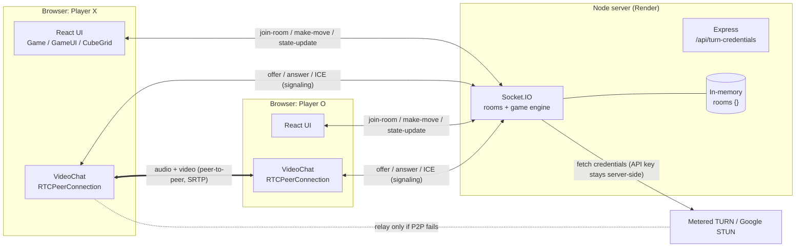
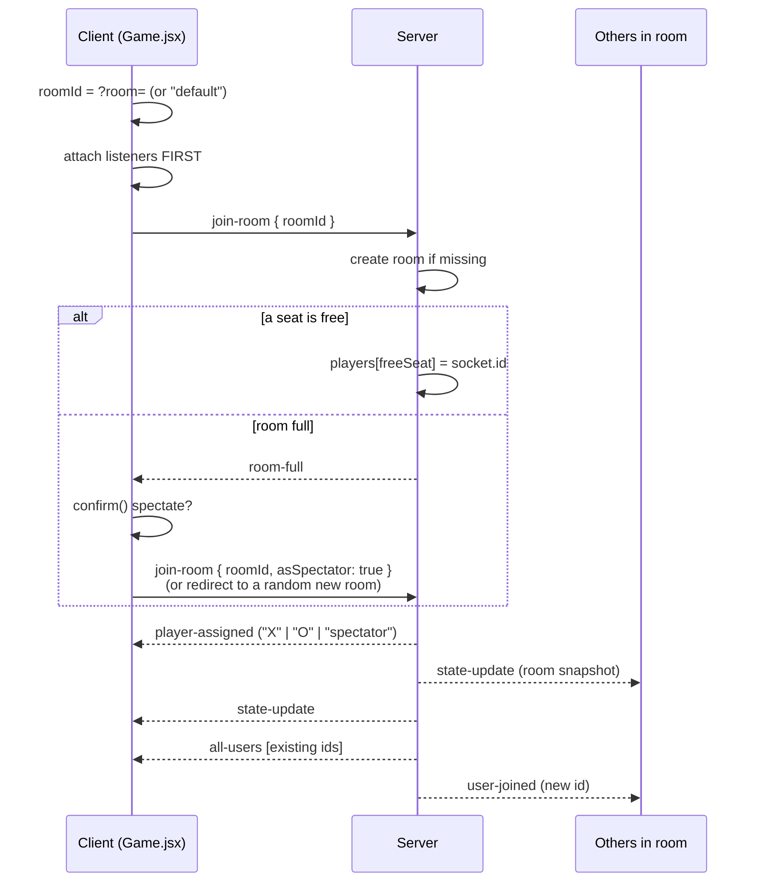
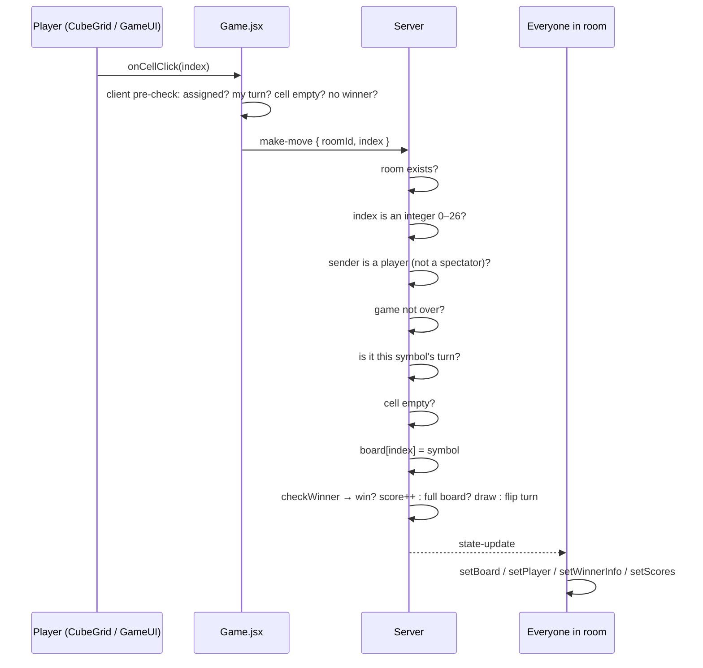

# 3D Multiplayer Tic Tac Toe (with Video Chat)

A real-time, browser-based **3×3×3 tic tac toe** game. Two players share a room link, play on a rotatable 3D cube, and see and hear each other over **peer-to-peer WebRTC video**. Anyone else who opens the link joins as a **spectator**.

> **One-line pitch:** "It looks like a game, but it's really a small real-time system: 3D rendering on the client, a server-authoritative game engine over WebSockets, and a WebRTC mesh for video, all coordinated through one Socket.IO connection."

This README has two jobs:

1. **Document the project:** what it does, how it works, why it's built this way.
2. **Prepare you for interviews:** every design decision, the challenges, the known weaknesses, and the questions you're likely to be asked, with answers.

---

## Table of Contents

1. [Features](#1-features)
2. [Tech Stack and Why Each Piece Was Chosen](#2-tech-stack-and-why-each-piece-was-chosen)
3. [Repository Structure](#3-repository-structure)
4. [Architecture](#4-architecture)
5. [The Game Model: 27 Cells and 49 Winning Lines](#5-the-game-model-27-cells-and-49-winning-lines)
6. [Server State and the Socket Event Contract](#6-server-state-and-the-socket-event-contract)
7. [End-to-End Flows](#7-end-to-end-flows)
8. [Frontend Deep Dive](#8-frontend-deep-dive)
9. [WebRTC Video Deep Dive](#9-webrtc-video-deep-dive)
10. [Design Decisions and Trade-offs](#10-design-decisions-and-trade-offs)
11. [How the Project Was Built (Timeline)](#11-how-the-project-was-built-timeline)
12. [Challenges and How They Were Solved](#12-challenges-and-how-they-were-solved)
13. [Known Issues and Limitations](#13-known-issues-and-limitations)
14. [What I Would Improve Next](#14-what-i-would-improve-next)
15. [Interview Preparation](#15-interview-preparation)
16. [Running Locally and Deployment](#16-running-locally-and-deployment)
17. [Glossary](#17-glossary)

---

## 1. Features

| Feature | Details |
|---|---|
| **3D board** | 27 cubes in a 3×3×3 grid, rendered with Three.js through React Three Fiber. You can orbit, zoom and click cells directly in 3D. |
| **Layer mini-maps** | The HUD shows three flat 3×3 boards, one per layer. You can play by clicking them too, and hovering a layer dims the rest of the cube. |
| **Real-time multiplayer** | Rooms are identified by `?room=<id>` in the URL. The first visitor is **X**, the second is **O**. |
| **Server-authoritative rules** | The server validates every move, detects wins and draws, and owns turn order. Clients only *request* actions. |
| **Spectators** | A third visitor is asked whether to spectate. Spectators can watch but can't move or reset (enforced on the server). |
| **Series scoreboard** | X wins, O wins and draws are kept per room. Resetting the board keeps the score. |
| **Video and audio chat** | A WebRTC mesh between everyone in the room, with mute and camera toggles, a draggable video panel and a separate spectator gallery. |
| **Robust connectivity** | TURN credentials are fetched server-side (Metered.ca) with a STUN fallback. ICE timeouts, automatic retries and a connection status indicator handle bad networks. |
| **Polish** | Smooth colour and scale transitions, a pulsing glow on the winning line, hover feedback, "copy room link", and a "new room" button. |

---

## 2. Tech Stack and Why Each Piece Was Chosen

| Layer | Technology | Why it was chosen |
|---|---|---|
| UI framework | **React 19** | Component model keeps game state, HUD, 3D scene and video cleanly separated. Hooks (`useEffect`, `useRef`, `useMemo`, `useCallback`) fit the event-driven socket and WebRTC code. |
| Build tool | **Vite 7** | Near-instant dev server and HMR, zero-config React plugin, small production builds. |
| 3D rendering | **Three.js** via **@react-three/fiber 9** and **@react-three/drei 10** | A real 3D scene, with a camera, lighting, raycasting for clicks and `useFrame` animation, written declaratively as React components instead of imperative scene-graph code. Drei gives `OrbitControls` for free. |
| Backend | **Node.js** and **Express 5** | Same language on both sides. Express hosts the REST endpoint for TURN credentials and the HTTP server that Socket.IO attaches to. |
| Realtime transport | **Socket.IO 4** | Persistent bidirectional connection with built-in **rooms** (`socket.join`, `io.to(room).emit`), acknowledgements (callbacks) and automatic reconnection. It's the game channel *and* the WebRTC signaling channel. |
| Video and audio | **WebRTC** (`RTCPeerConnection`, `getUserMedia`) | Media flows directly between browsers, so the server never carries video bandwidth. |
| NAT traversal | **STUN** (Google public) and **TURN** (Metered.ca) | STUN lets a peer discover its public address. TURN relays media when a direct path is impossible (symmetric NAT, corporate firewalls, some mobile networks). |
| Hosting | **Render** (backend) | Free tier that supports long-lived WebSocket connections. |

**What was deliberately *not* used, and why:**
- **No Redux or Zustand.** State is small and lives in one container component (`Game.jsx`). The server is the real store.
- **No database.** Rooms are short-lived, so in-memory state is simpler and fast enough for the scope (see [Limitations](#13-known-issues-and-limitations)).
- **No media server (SFU).** A two-player game rarely needs more than a few peers, so a P2P mesh is free and simple.

---

## 3. Repository Structure

```
tic_tac_toe/
├── client/                         # React + Vite frontend
│   ├── index.html
│   ├── vite.config.js
│   └── src/
│       ├── main.jsx                # React entry point (createRoot)
│       ├── App.jsx                 # Full-screen <Canvas>, lights, OrbitControls
│       ├── index.css               # Global styles / CSS variables
│       ├── network/
│       │   └── socket.js           # Single shared Socket.IO client instance
│       ├── game/
│       │   ├── winLines.js         # Generates all 49 winning lines
│       │   └── gameLogic.js        # checkWinner(board) helper (client copy)
│       └── components/
│           ├── Game.jsx            # State container: socket listeners, move/reset requests
│           ├── CubeGrid.jsx        # The 27 3D cells, animations, click/hover
│           ├── GameUI.jsx (+ .css) # HUD: role, turn, score, room link, layer mini-boards
│           ├── VideoChat.jsx (+ .css) # WebRTC mesh, media controls, draggable panel
│           └── LandingPage.jsx (+ .css) # Create/join room screen (built, not wired in yet)
├── server/
│   ├── index.js                    # Express + Socket.IO: rooms, rules, scores, signaling, TURN
│   └── winLines.js                 # Server copy of the 49 winning lines
├── test_socket.mjs                 # Manual two-client connection smoke test
├── client/test_socket.js           # Same idea, longer timeout
└── IMPORTANT_CODE.md               # Line-by-line notes on the hardest code
```

The most important files to know well:

| File | Why it matters |
|---|---|
| [server/index.js](server/index.js) | The authority. It owns rooms, roles, turn order, validation, win and draw detection, scores, cleanup and signaling relay. |
| [client/src/components/Game.jsx](client/src/components/Game.jsx) | The bridge between the server and the UI. It turns socket events into React state. |
| [client/src/components/CubeGrid.jsx](client/src/components/CubeGrid.jsx) | Maps the 1D board into 3D space and handles animation. |
| [client/src/components/VideoChat.jsx](client/src/components/VideoChat.jsx) | The most complex file. It handles the WebRTC mesh, signal queuing, ICE retries and media fallbacks. |
| [client/src/game/winLines.js](client/src/game/winLines.js) | The core algorithmic idea of the game. |

---

## 4. Architecture



### The three subsystems

| Subsystem | Who owns it | Transport |
|---|---|---|
| **Game state** (board, turn, winner, scores, roles) | **Server** | Socket.IO events |
| **Rendering** (3D scene, HUD, animations) | **Client** | Local |
| **Media** (camera, mic, video) | **Peers** | WebRTC (signaling over Socket.IO) |

### The trust boundary (the key idea)

> **The client renders the game; the server owns the truth.**

The browser may show the board, highlight cells and *pre-check* whether a click makes sense, which is good UX because it avoids pointless round-trips. But the browser is never trusted to decide:
- whether it's your turn
- whether a cell is free
- whether you're a player or a spectator
- whether someone won

Every one of those checks is repeated on the server in `make-move` / `reset-game`. If someone opens DevTools and emits `make-move` by hand, the server silently ignores it.

---

## 5. The Game Model: 27 Cells and 49 Winning Lines

### Representing a 3D board as a flat array

The board is a plain array of 27 entries (`null | "X" | "O"`). A 3D coordinate maps to an index with:

```js
const idx = (x, y, z) => x * 9 + y * 3 + z;   // x, y, z ∈ {0, 1, 2}
```

This is **row-major order** (the same layout C uses for multi-dimensional arrays). Each `x` "slab" holds 9 cells, each `y` row inside it holds 3, and `z` picks the cell.

**Why a flat array instead of `board[x][y][z]`?**
- It's trivial to serialize and send over the network (`Array(27).fill(null)`).
- A move is a single integer `index`, which is easy to validate and easy to send.
- Copying and comparing are cheap. React and Socket.IO both like flat, plain data.
- Winning lines become plain triples of integers.

### Counting the winning lines

[winLines.js](client/src/game/winLines.js) generates every line of three once, at module load:

| Category | How | Count |
|---|---|---|
| Rows along **z** | fix `x, y` | 9 |
| Columns along **y** | fix `x, z` | 9 |
| Stacks along **x** | fix `y, z` | 9 |
| Face diagonals in planes of constant **x** | 2 per plane × 3 | 6 |
| Face diagonals in planes of constant **y** | 2 per plane × 3 | 6 |
| Face diagonals in planes of constant **z** | 2 per plane × 3 | 6 |
| **Space diagonals** (corner to corner through the centre) | | 4 |
| **Total** | | **49** |

> Interview check: the general formula for an n×n×n cube is `((n+2)³ − n³) / 2`, and for n = 3 that gives (125 − 27) / 2 = **49**. ✔

### Win detection

```js
for (const [a, b, c] of WIN_LINES)
  if (board[a] && board[a] === board[b] && board[a] === board[c])
    return { winner: board[a], line: [a, b, c] };
```

- **Complexity:** O(49), effectively constant. A check runs once per move, so there's no need for anything smarter.
- **Why precompute lines?** The alternative is direction-vector scanning from the last move. That's more general (it scales to n×n×n or connect-k) but harder to read and to get right. For a fixed 3×3×3 board, a lookup table is simpler, faster and obviously correct.
- It returns the **line** as well as the winner, so the client can make those three cubes glow.

### Fun fact for interviews

In 3×3×3 tic tac toe **a draw is mathematically impossible**: any way of filling all 27 cells with 14 X's and 13 O's contains a complete line. The first player can also force a win (take the centre, cell 13). The draw branch in the server is defensive code. It keeps the engine correct if the rules or board size ever change. Mentioning this shows you thought about the game, not just the code.

---

## 6. Server State and the Socket Event Contract

### Room state (in memory)

```js
rooms[roomId] = {
  board: Array(27).fill(null), // null | "X" | "O"
  playerTurn: "X",             // whose turn
  players: [null, null],       // fixed seats: [X socket id, O socket id], null = empty
  spectators: [],              // socket ids
  winner: null,                // { winner: "X" | "O" | "Draw", line: number[] }
  scores: { X: 0, O: 0, draws: 0 }
};
```

The **role isn't stored separately**. It's derived from the socket's seat in `players` (seat 0 = X, seat 1 = O). The seats are **fixed**: when a player leaves, their seat becomes `null` instead of being removed, so the other player never changes symbol mid-game. A new joiner takes the first free seat.

### Events: client → server

| Event | Payload | Server behaviour |
|---|---|---|
| `join-room` | `{ roomId, asSpectator? }` | Creates the room if needed. Adds the socket as a player (if fewer than 2 players) or a spectator (if requested). Otherwise replies `room-full`. |
| `make-move` | `{ roomId, index }` | Validates the move (see §7.2), applies it, checks win or draw, flips the turn and broadcasts. |
| `reset-game` | `{ roomId }` | Players only. Clears the board, turn and winner. **Keeps scores.** |
| `get-turn-credentials` | *(ack callback)* | Returns `{ iceServers }` using a Socket.IO acknowledgement. |
| `webrtc-offer` / `webrtc-answer` / `webrtc-ice-candidate` | `{ targetId, offer \| answer \| candidate }` | Relays the message **only to `targetId`**, stamped with `senderId`. |

### Events: server → client

| Event | Sent to | Meaning |
|---|---|---|
| `player-assigned` | the joining socket | `"X"`, `"O"` or `"spectator"` |
| `state-update` | whole room | Full room snapshot. The client replaces its state with it. |
| `room-full` | the joining socket | Two players already present. The client asks "spectate or new room?" |
| `all-users` | the joining socket | Socket ids of everyone already in the room. The new joiner will **offer** to each. |
| `user-joined` | everyone else | A new peer arrived. Prepare a connection and **wait** for their offer. |
| `user-disconnected` | everyone else | Tear down that peer's connection. |
| `webrtc-*` | the target peer | Relayed signaling messages |

### REST

| Route | Purpose |
|---|---|
| `GET /api/turn-credentials` | Same ICE server list as the socket event, as plain HTTP |

**Why broadcast the full state instead of diffs?** The whole room is under 1 KB. Sending a full snapshot makes every client **idempotent and self-healing**: a missed or duplicated event can't leave a client out of sync, because the next snapshot overwrites everything. Diffs would save bytes nobody needs to save, at the cost of ordering and consistency bugs.

---

## 7. End-to-End Flows

### 7.1 Joining a room



**Why listeners are attached before emitting `join-room`:** if you emit first, the server's `player-assigned` reply can arrive before `socket.on("player-assigned")` is registered, and the event is silently lost. This was a real bug during development (see [Challenges](#12-challenges-and-how-they-were-solved)).

### 7.2 Making a move



The client pre-check is **UX only**. It avoids pointless network calls and gives instant feedback. Correctness comes from the **server** checks.

### 7.3 Reset and "Play Again"

- Only sockets in `room.players` may reset. Spectator attempts are logged as `[SECURITY]` and ignored.
- The board, `playerTurn` and `winner` are cleared. **`scores` are kept**, which is what makes a "series score" possible.
- The UI shows **↻ Reset** during a game and **★ Play Again** after one, and hides both for spectators.

### 7.4 Disconnects

```
on disconnect:
  for every room containing this socket:
    free their seat (players[i] = null) and remove from spectators
    tell others: user-disconnected (so VideoChat closes that peer)
    if room is now empty → delete room   (prevents a memory leak)
    else                 → broadcast state-update
```

### 7.5 Video call setup (summary; full detail in §9)

1. `VideoChat` mounts and **queues** any signaling events that arrive early.
2. It gets the camera and mic, falling back to audio-only, then video-only.
3. It fetches ICE servers with a 5-second timeout and falls back to STUN.
4. It marks itself ready and **drains** the queued signals.
5. The new joiner sends an **offer** to every existing user. Existing users **answer**.
6. ICE candidates flow both ways. Media goes peer-to-peer.

---

## 8. Frontend Deep Dive

### Component tree

```
main.jsx
└── App.jsx
    └── <Game>                      ← owns all game state + socket listeners
        ├── <GameUI/>               ← HUD (DOM overlay)
        ├── children(render-prop) → <Canvas>
        │                             ├── lights
        │                             ├── <CubeGrid/> → 27 × <Cell/>
        │                             └── <OrbitControls/>
        └── <VideoChat/>            ← WebRTC (DOM overlay)
```

### `App.jsx` and the render-prop pattern

`Game` receives a **function as its child** and calls it with `{ board, handleMove, winnerInfo, activeLayer }`. This keeps `Game` free of any 3D code: it doesn't know or care that the board is drawn with Three.js. The Canvas could be swapped for a 2D board without touching the state logic.

### `Game.jsx`: the state container

- Holds `board`, `player` (whose turn), `playerSymbol` (my role), `winnerInfo`, `scores`, `spectatorCount`, `playersList` and `activeLayer`.
- Reads `roomId` from the URL. The **URL is the room**, so sharing a link is the invite system. There are no accounts and no lobby server.
- One `useEffect` (keyed on `roomId`) attaches listeners, emits `join-room`, and **cleans up with `socket.off`** on unmount. Without cleanup, React StrictMode's double-mount or a hot reload would register duplicate listeners and every update would apply twice.
- `socket.js` exports **one shared socket instance** (a module-level singleton). Every component uses the same connection, so the game and video share one socket id, which is what lets the server relate "player X" to "this video peer".

### `CubeGrid.jsx`: from index to 3D space

```js
index    = x * 9 + y * 3 + z
position = [(x-1)*(size+gap), (y-1)*(size+gap), (z-1)*(size+gap)]   // centred on origin
```

Subtracting 1 centres the cube on the origin, so `OrbitControls` rotates around the middle cell.

**Each `<Cell>`:**
- is a `mesh` with `boxGeometry` and a transparent `meshStandardMaterial`
- uses `onPointerDown`, `onPointerEnter` and `onPointerLeave`. React Three Fiber **raycasts** the mouse into the scene for you. `e.stopPropagation()` makes sure only the **front-most** cube under the cursor reacts, not every cube behind it on the ray.
- picks a **target** colour, emissive glow, opacity and scale from its state (winning > dimmed > ghost preview > X > O > hovered > empty), then **lerps** towards it every frame inside `useFrame`:

```js
const speed = 6 * delta;           // frame-rate independent
mat.color.lerp(targetColor, speed);
mat.opacity += (targetOpacity - mat.opacity) * speed;
```

**Why animate in `useFrame` with refs instead of React state?** `useFrame` runs about 60 times a second. Calling `setState` that often would re-render React 60 times a second. Mutating the Three.js material **through a ref** skips React entirely, which is the standard R3F performance pattern. Multiplying by `delta` makes the animation the same speed at 30 fps and at 144 fps.

The winning line pulses with `0.4 + sin(Date.now() * 0.004) * 0.3` on the emissive intensity.

### `GameUI.jsx`: the HUD

- **Role badge** (X / O / 👁 spectator), **turn indicator**, **winner banner**
- **Series score** (X : O, plus draws when there are any)
- **Room code**: click to copy the full URL with `navigator.clipboard`
- **Buttons**: Reset / Play Again (players only), + New Room (random 6-character id from `Math.random().toString(36)`)
- **Layer mini-boards**: three 3×3 grids. `flippedRow = 2 - row` makes row 0 on screen match the *top* of the cube (y = 2), so the 2D view matches the 3D one. Clicking a mini-cell calls the same `handleMove`, so there are two input methods and one code path.

### `VideoChat.jsx`: UI side

- Splits streams into **main** (players) and **spectator** groups with `useMemo`, using `playersList` from the server. Players get the big draggable panel; spectators go to a small gallery.
- The local `<video>` is **`muted`** to stop you hearing your own echo.
- `srcObject` is set through a **callback ref** (`ref={el => el.srcObject = stream}`) because `srcObject` can't be set as a JSX attribute.
- The **draggable panel** uses `mousedown` → document-level `mousemove` / `mouseup` listeners, with touch equivalents. Listening on `document` means the drag doesn't break if the cursor moves faster than the panel. Positions are applied with `transform: translate()`, which is GPU-composited and doesn't trigger layout.
- Mute and camera toggles flip `track.enabled` instead of stopping the track. That's instant, needs no renegotiation, and the remote side just gets silence or black frames.

---

## 9. WebRTC Video Deep Dive

This is the hardest part of the project and the part interviewers dig into most.

### 9.1 The three things WebRTC needs

1. **Media**: `getUserMedia()` returns a `MediaStream` with audio and video tracks.
2. **Signaling**: peers must exchange an **SDP offer and answer** (codecs, media description) and **ICE candidates** (possible network addresses). WebRTC doesn't define *how*, so you bring your own channel. Here it's **Socket.IO**.
3. **NAT traversal**: **STUN** tells a peer its public IP and port. **TURN** relays the media when no direct path works.

### 9.2 Mesh topology

Every participant (players **and** spectators) holds one `RTCPeerConnection` per other participant, stored in `peersRef: Map<socketId, { peer, iceQueue, remoteDescSet }>`.

- Connections for N people: **N(N−1)/2**. That's 1 for 2 people and 6 for 4.
- Each client uploads its stream **N−1 times**. That's fine for a game room of 2 to 4 people and doesn't scale beyond about 5 or 6. The next step would be an SFU (see §14).

**Why the signaling messages carry `targetId`:** the first version broadcast offers to the whole room (`socket.to(roomId)`), which only works for exactly two people. With a third person, offers meant for one peer were applied by another. Routing each message to a single `targetId` and stamping it with `senderId` is what made the mesh possible.

### 9.3 Who sends the offer? (avoiding "glare")

If both sides send an offer at the same moment ("glare"), both connections end up in a broken state. The rule here is deterministic:

- The **new joiner** receives `all-users` and **creates an offer** to each existing user.
- **Existing users** receive `user-joined`, **create a peer object**, and **wait** for the offer.
- On a **retry**, only the side with the larger socket id (`socket.id > targetId`) re-offers, so both sides never retry-offer at once.

### 9.4 Two queues that fix race conditions

**Queue 1: pending signals (`pendingSignalsRef`).** `getUserMedia` (waiting for the user to click "Allow") and the TURN fetch are **asynchronous**. Signaling events can arrive before they finish. If an offer were answered before the local tracks were added, the other side would get a connection **with no media**. So until `isReadyRef` is true, every incoming signal is pushed to a queue, then **drained in order** once media and ICE servers are ready.

**Queue 2: ICE candidates (`peerObj.iceQueue`).** ICE candidates often arrive **before** the remote description has been set, and `addIceCandidate()` throws if called too early. Candidates are buffered per peer and drained right after `setRemoteDescription()`.

### 9.5 Media fallbacks

```
try video + audio
  → catch: try audio only
    → catch: try video only
      → catch: join with no local media (can still receive others)
```

A missing webcam, a denied permission or a device in use by another app degrades the experience instead of breaking it. The mute and camera buttons are synced to the tracks that were actually obtained.

### 9.6 TURN credentials: why fetch them on the server

- The Metered **API key lives only in the server's environment** (`METERED_API_KEY`). If the client fetched credentials directly, the key would ship in the JS bundle for anyone to steal.
- The server hands out **short-lived** credentials through a Socket.IO **acknowledgement** (`socket.emit("get-turn-credentials", cb)`).
- **Layered fallbacks**: no key → 5 Google STUN servers. Metered error → 2 STUN servers. Client-side 5-second timeout → built-in STUN list. Video may not connect on hard networks, but the app never hangs.
- `iceCandidatePoolSize: 10` pre-gathers candidates to speed up connection.

### 9.7 Connection health: timeouts and retries

| ICE state | Action |
|---|---|
| `checking` | status = "connecting", start a **15-second ICE timeout** |
| `connected` / `completed` | status = "connected", clear the timeout, reset the retry count |
| `disconnected` | status = "connecting", start the timeout (it often recovers by itself) |
| `failed`, or timeout fires | **retry**: close the peer, wait 1–1.5 seconds (random **jitter** so both sides don't collide), re-offer. At most **2 retries**, then "failed". |

The per-peer statuses roll up into one indicator (waiting / connecting / retrying / connected / failed) with priority **failed > retrying > connecting > connected**.

### 9.8 Cleanup

On unmount: remove every socket listener, `close()` every `RTCPeerConnection`, and `stop()` every local track, which turns off the camera light. On `user-disconnected`: close that one peer, clear its timeout, and remove its stream and status.

---

## 10. Design Decisions and Trade-offs

| # | Decision | Alternatives considered | Why this choice | Cost / trade-off |
|---|---|---|---|---|
| 1 | **3×3×3 board** instead of 3×3 | Classic 2D | More interesting algorithmically (49 lines, 3D indexing) and visually memorable | 3×3×3 is "solved": the first player can force a win |
| 2 | **Server-authoritative** state | Trust the clients, or P2P state over WebRTC data channels | Prevents cheating (out-of-turn moves, overwriting cells, spectators acting) and gives one source of truth | Every move needs a round-trip, which is fine for a turn-based game |
| 3 | **Full-state broadcast** (`state-update`) | Send diffs or individual moves | Idempotent and self-healing. Clients can't drift. | Slightly more bytes (under 1 KB, so irrelevant) |
| 4 | **Flat array of 27** | Nested 3D array, or a map of coordinates | Easy to serialize, validate, index and compare | Needs the `idx()` helper to reason about |
| 5 | **Precomputed win lines** | Scan along direction vectors from the last move | Simple, obviously correct, O(49) | Doesn't generalize to n×n×n without regenerating |
| 6 | **Socket.IO** | Raw `ws`, Server-Sent Events, HTTP polling, Firebase | Rooms, acks and reconnection built in. One channel for game and signaling. | Its own protocol (not plain WebSocket), and needs sticky sessions to scale |
| 7 | **Rooms via URL query** | Accounts and lobbies | Zero friction: share a link and play | Anyone with the link can join, and room ids are guessable-ish |
| 8 | **In-memory rooms** | Redis or a database | No infrastructure, fast | Lost on restart, and only works with a single server instance |
| 9 | **WebRTC P2P** for video | Relay video through the server, or a hosted SDK (Agora, Twilio) | Free, lowest latency, server bandwidth ≈ 0 | NAT problems (solved with TURN), and the mesh doesn't scale |
| 10 | **Mesh** instead of SFU | mediasoup or LiveKit SFU | No media server needed for 2 to 4 people | O(N²) connections, and upload grows with N |
| 11 | **TURN creds fetched server-side** | Hard-code them in the client | Keeps the API key secret | One extra request before the call starts |
| 12 | **React Three Fiber** | Raw Three.js, Babylon.js, CSS 3D transforms | React mental model, raycast events, `useFrame`, drei helpers | Extra abstraction, so you need to know when to bypass React (refs in `useFrame`) |
| 13 | **Animation via refs and lerp in `useFrame`** | CSS transitions, react-spring | No React re-renders per frame, smooth and frame-rate independent | Imperative code inside a declarative app |
| 14 | **Render-prop `Game`** | Context, or a state library | State logic stays independent of the renderer | Slightly unusual pattern for readers |
| 15 | **Spectators join the video mesh** | Players-only video | Spectators can talk and be seen, like a "stream" room | More connections per client |
| 16 | **Scores survive reset** | Reset everything | Supports a best-of series | Scores are lost when the room empties |

---

## 11. How the Project Was Built (Timeline)

Reconstructed from the git history. Use this when asked to "walk through how you built it".

| Phase | Dates | What happened | Key commits |
|---|---|---|---|
| **1. Core game** | Jan 29, 2026 | Vite + React + R3F skeleton, 3D cube, mini-boards, win-line generator, first Socket.IO server | `2b8b0bd` |
| **2. Multiplayer** | Jan 30 | Turn sync and reset across two browsers | `6f0c3b1` |
| **3. Server authority and first video** | Feb 2–3 | Win detection moved to the server. First 1:1 WebRTC call with controls. Dynamic `?room=` rooms. Deployed to Render (`process.env.PORT`). | `6fa6613`, `89d9e46`, `3bd17e1` |
| **4. Stability fixes** | Feb 10–11 | Rooms not cleaned up on disconnect (stale state). Socket forced to WebSocket transport. "default" room bug. | `705b93b`, `eebc66e`, `85758b2` |
| **5. The WebRTC debugging marathon** | Feb 17–18 | About 12 commits in two days: STUN fixes, console-logging the signaling path, a server crash from stray `peer` references, sending `ready-for-call` to the wrong player | `ebbbbab` … `6261540` |
| **6. Re-architecture to a mesh** | Mar 7 | TURN via Metered, async init, re-sync on rejoin, **targeted signaling (`targetId`/`senderId`)**, spectators, queued signals, ICE retries and status widget, **spectator permission checks on the server** | `bb787a4` … `b780f51` |
| **7. UX polish** | May 31 – Jun 7 | New colour scheme, scrollable layer UI, **persistent series scoreboard**, spectator video gallery, icon and aspect-ratio fixes, README and docs | `ea06c90` … `ebcbc73` |

**The story to tell:** *"I built it in layers: rules first, then rendering, then multiplayer, then I hardened the server, then video. Video was by far the hardest part. My first design was a 1:1 call triggered by the server, and it kept failing because of race conditions. I eventually re-architected it into a targeted-signaling mesh with explicit queues and retries, and that's what made it reliable."*

---

## 12. Challenges and How They Were Solved

Use the **STAR** format in interviews: **S**ituation, **T**ask, **A**ction, **R**esult.

### Challenge 1: Lost socket events (listener ordering)
- **Problem:** players sometimes never got their X/O role.
- **Cause:** `join-room` was emitted *before* `socket.on("player-assigned")` was registered, so a fast server reply arrived with nobody listening.
- **Fix:** attach every listener first, then emit, and remove them with `socket.off` in the `useEffect` cleanup so StrictMode or HMR can't double-register them.
- **Lesson:** with event-driven code, **subscription order is part of correctness**.

### Challenge 2: Stale rooms and ghost players
- **Problem:** after refreshes, rooms looked "full" with players who had already left.
- **Cause:** the server had no disconnect cleanup, so dead socket ids stayed in `players`.
- **Fix:** the `disconnect` handler removes the socket from every room, notifies peers, and **deletes empty rooms** (which also prevents a memory leak).

### Challenge 3: The WebRTC "who calls whom" race (the big one)
- **Situation:** the first design had the server emit `ready-for-call` / `start-call` when the second player joined, and one side would then create an offer.
- **Problem:** calls connected only sometimes. Offers arrived before the receiver had its camera stream or even its listeners, and at one point the server sent the trigger to the *wrong* player. A stray `peer` reference in server code even crashed the handler.
- **Action:** removed the server-triggered call entirely and replaced it with a deterministic rule (the **new joiner offers to everyone in `all-users`**), plus a **pending-signal queue** that holds every signaling message until local media and ICE servers are ready, plus a **per-peer ICE candidate queue**.
- **Result:** call setup no longer depends on timing. Any arrival order of events leads to the same final state.

### Challenge 4: It works on localhost but not across networks
- **Problem:** video worked on the same Wi-Fi but failed between different networks (mobile data, college or office networks).
- **Cause:** STUN alone can't get through **symmetric NATs** and strict firewalls.
- **Fix:** added **TURN** (Metered.ca) with credentials fetched **server-side** to protect the API key, a multi-level STUN fallback, a 15-second ICE timeout, and up to 2 jittered retries with a visible status indicator.

### Challenge 5: Scaling from 1:1 to N people
- **Problem:** adding spectators broke video, because signaling broadcast to the whole room and a third peer consumed offers meant for someone else.
- **Fix:** **targeted signaling**: every message carries `targetId` (server routes it) and `senderId` (receiver knows which `RTCPeerConnection` it belongs to). Peers are stored in a `Map` keyed by socket id.

### Challenge 6: Cheating and spectator abuse
- **Problem:** the early client-only checks could be bypassed from the browser console.
- **Fix:** the server validates room existence, index range, role, game-over, turn and cell for every move, and role for every reset. Rejected attempts are logged with `[SECURITY]`.

### Challenge 7: Per-frame animation performance
- **Problem:** smooth hover and colour transitions on 27 cubes without re-rendering React every frame.
- **Fix:** mutate the material and mesh through **refs** inside `useFrame`, use **delta-scaled lerp** for frame-rate independence, and call `stopPropagation` so only the front cube reacts to the pointer.

### Challenge 8: Devices and permissions
- **Problem:** users without a camera, or who denied permissions, couldn't join at all.
- **Fix:** progressive `getUserMedia` fallbacks (A+V → A → V → none), with the UI controls synced to the tracks actually obtained.

### Challenge 9: Free-tier deployment
- Render injects `PORT`, so the server uses `process.env.PORT || 3001`.
- Free instances **sleep**, so the first connection can take 30 seconds or more (a cold start).
- The client forces `transports: ["websocket"]` to skip the long-polling upgrade, which caused problems through Render's proxy.

---

## 13. Known Issues and Limitations

Being upfront about these in an interview shows engineering maturity. Each one comes with its fix.

### Bugs found and fixed while documenting

These four bugs turned up while writing this README. They're fixed now, and they make a good interview story: "I found them by explaining my own code."

| Bug | Root cause | Fix |
|---|---|---|
| **Role shift on disconnect.** If X left, O silently became X on the server, but the client still thought it was O, so the game got stuck. | Roles were derived from the index in `players`, and disconnect used `filter()`, which shifted everyone down. | `players` is now two **fixed seats** `[X, O]`. Disconnect sets the seat to `null` instead of removing it, and a new joiner takes the first free seat. Roles never change under a connected player. |
| **No validation of the move `index`.** A crafted `make-move` with `99` or `"foo"` wrote outside the board. | The server trusted the shape of client input. | `make-move` now rejects anything that isn't an integer from 0 to 26. |
| **Ghost preview never showed.** | `CubeGrid` expected `playerSymbol` and `currentTurn`, but `App.jsx` never passed them, so `isMyTurn` was always false. | `Game` now passes both through the render prop. |
| **Layer hover highlighted the wrong slice.** | The HUD mini-boards index by `x` (`layer*9 + …`), but `CubeGrid` dimmed by `z`. | `CubeGrid` now uses `layer = x`, so both views agree. |

### Remaining limitations

| # | Issue | Where | Impact | Fix |
|---|---|---|---|---|
| 1 | **In-memory state, single instance.** | `rooms = {}` | Restarts wipe games, and you can't run two servers | Redis for state and `@socket.io/redis-adapter`, or sticky sessions |
| 2 | **Hard-coded backend URL.** | `network/socket.js` | Local development talks to production | `import.meta.env.VITE_SERVER_URL` |
| 3 | **CORS `origin: "*"`.** | Socket.IO config | Any site can connect | Whitelist the frontend origin |
| 4 | **Socket ids are broadcast** in `state-update`. | `state-update` | Leaks internal ids, though they're harmless | Send a client-safe view model |
| 5 | **No rate limiting or auth.** | All events | Spam is possible | Per-socket rate limit, optional names or auth |
| 6 | **Mesh doesn't scale.** | `VideoChat.jsx` | Each client uploads N−1 streams | SFU (LiveKit or mediasoup) |
| 7 | **`LandingPage.jsx` isn't wired in.** | `App.jsx` | Visitors without `?room=` all land in the shared `"default"` room | Route `/` → landing page and `/?room=` → game |
| 8 | **Minimal tests.** `test_socket*.js` are manual smoke scripts that still listen for the removed `ready-for-call` event. | repo root | Regressions aren't caught | Unit-test `checkWinner` and the move validation, and integration-test sockets with `socket.io-client` + Vitest |
| 9 | **Win-line code is duplicated** in client and server. | `winLines.js` ×2 | The copies can drift apart | A shared package or workspace |
| 10 | `THREE.Color` objects are created on every render of each cell. | `CubeGrid.jsx` | Minor garbage-collection pressure | Hoist them to module-level constants |

---

## 14. What I Would Improve Next

**Correctness:** add a test suite (Vitest for `checkWinner`, socket integration tests for every rule).

**Scalability**
- Redis for room state and the Socket.IO Redis adapter, so the server can scale horizontally behind a load balancer with sticky sessions.
- An SFU for video when rooms grow beyond about 4 people.
- A TTL on idle rooms.

**Product**
- Wire in the landing page, player names, reconnect-to-same-seat (a session token instead of the socket id), and a rematch with alternating first player.
- An AI opponent using **minimax with alpha-beta pruning**. The 3×3×3 state space is small enough, and a centre-first heuristic helps.
- Move history and replay, plus chat.
- Mobile UX: tap-to-select instead of hover, and a responsive HUD.

**Ops:** environment config, structured logging instead of `console.log`, health check endpoint, uptime ping to avoid cold starts, and a CI pipeline (lint + test + build).

---

## 15. Interview Preparation

### 15.1 The 30-second pitch

> "I built a real-time multiplayer 3D tic tac toe game with built-in video chat. The board is a 3×3×3 cube rendered with React Three Fiber. A Node and Socket.IO server is the single source of truth: it validates every move, detects wins across all 49 possible lines, and broadcasts state to the room. Video is peer-to-peer WebRTC, with Socket.IO as the signaling channel and TURN for hard networks. The most interesting engineering was making WebRTC reliable: I went from a fragile server-triggered 1:1 call to a targeted-signaling mesh with event queues, ICE retries and spectator support."

### 15.2 The 2-minute walkthrough (structure)

1. **What and why:** a 3D twist on a simple game, to learn real-time systems.
2. **Architecture:** three subsystems (game state on the server, rendering on the client, media peer-to-peer).
3. **Game model:** flat array of 27, `x*9 + y*3 + z`, 49 precomputed lines.
4. **Trust boundary:** the client requests, the server decides, and the full state is broadcast.
5. **Video:** signaling over sockets, the new joiner offers, two queues, TURN, retries.
6. **Hardest bug:** WebRTC race conditions → re-architecture.
7. **What's next:** Redis and a horizontally scalable server, an SFU, tests, an AI opponent.

### 15.3 Likely questions and how to answer them

#### Project and motivation

**Q: Why did you build this?**
A: I wanted something small enough to finish but deep enough to cover real full-stack problems: 3D rendering, real-time state sync, a trust boundary between client and server, and peer-to-peer networking. Tic tac toe keeps the rules simple, so the complexity is all in the system.

**Q: What are you most proud of?**
A: Two things. The server-authoritative design, because cheating is impossible from the client. And making WebRTC reliable: diagnosing race conditions, then designing the queue and offerer rules that fixed them.

**Q: What was the hardest part?**
A: WebRTC signaling (§12, Challenge 3). Tell it as a STAR story: fragile 1:1 trigger → root cause was asynchronous ordering → deterministic offerer + pending queue + ICE queue → reliable.

#### Game logic and algorithms

**Q: How do you store a 3D board?**
A: As a flat array of 27 with `index = x*9 + y*3 + z` (row-major). It's easy to serialize and validate, and a move is just an integer.

**Q: How many winning lines are there, and how do you find them?**
A: 49: 27 straight lines (9 per axis), 18 face diagonals (2 in each of 9 planes) and 4 space diagonals. They're generated once with loops, and `checkWinner` just checks each triple. The formula is `((n+2)³ − n³)/2`.

**Q: What's the complexity of win checking? Could it be faster?**
A: O(49) per move, effectively constant. You could check only the lines through the last move (at most 13 for the centre cell) using a precomputed `cell → lines` index, but at this size it doesn't matter. I'd only do that for larger boards.

**Q: How would you generalize to n×n×n or connect-k?**
A: Generate lines from the 13 direction vectors (half of the 26 neighbour directions), walking k steps from each starting cell. Or check only from the last move, counting in both directions along each vector.

**Q: Can 3×3×3 end in a draw?**
A: No. Any full board contains a line, and the first player can force a win from the centre. My draw handling is defensive in case the rules or board size change.

**Q: How would you build an AI opponent?**
A: Minimax with alpha-beta pruning, plus heuristics (centre first, block forks). Memoize positions in a transposition table, and use symmetry reduction since the cube has 48 symmetries.

#### Realtime and backend

**Q: Why Socket.IO and not plain WebSockets?**
A: Built-in rooms, acknowledgements (used for TURN credentials), automatic reconnection, and fallback transports. Plain `ws` would mean re-implementing rooms and acks. The trade-off is that it's a custom protocol, so you need a Socket.IO client.

**Q: Why WebSockets instead of HTTP polling?**
A: Moves have to be pushed to the opponent immediately. Polling wastes requests and adds latency. Server-Sent Events are one-way only.

**Q: What does "server-authoritative" mean, and why does it matter?**
A: The server holds the real state and validates every action. Clients only send intents. Otherwise anyone could emit `make-move` from DevTools to play out of turn or overwrite cells. Six checks run on every move: room exists, index is an integer from 0 to 26, sender is a player, game not over, correct turn, cell empty.

**Q: Why do you validate on the client too?**
A: For UX: instant feedback and no wasted round-trips. It's an optimisation, never a security measure.

**Q: Why broadcast full state instead of individual moves?**
A: It's idempotent and self-healing. A dropped or reordered event can't desync a client, because the next snapshot fixes it. The state is under 1 KB.

**Q: What happens with two simultaneous moves?**
A: Node runs JavaScript on a single thread, so event handlers run one at a time. The first move flips `playerTurn`, and the second fails the turn check. There's no race inside one process. With multiple servers you'd need shared state with atomic updates, such as a Redis transaction or Lua script.

**Q: What happens when someone disconnects?**
A: They're removed from players and spectators, others get `user-disconnected` (so the video peer closes) plus a fresh `state-update`, and empty rooms are deleted. *(Bonus credit: mention the role-shift bug I found and fixed. Roles were derived from the array index and `filter()` shifted O into X's seat, so I switched to fixed seats that become `null` on disconnect.)*

**Q: How would you scale this to 100k concurrent rooms?**
A: Move room state to Redis. Use the Socket.IO Redis adapter so `io.to(room)` works across instances. Put the servers behind a load balancer with **sticky sessions** (Socket.IO's handshake needs them). Shard rooms by id. Set TTLs on idle rooms. Use an SFU or managed TURN for media. The game logic itself is cheap, so connections and media are the bottleneck.

**Q: How would you let a player reconnect after a refresh?**
A: Issue a session token (stored in localStorage) when they join, map token → seat on the server, and on reconnect re-bind the new socket id to the existing seat. Keep the seat open for a grace period before giving it away.

#### WebRTC

**Q: Explain how a WebRTC call is established.**
A: Get local media. Create an `RTCPeerConnection` with ICE servers and add the tracks. Caller: `createOffer` → `setLocalDescription` → send via signaling. Callee: `setRemoteDescription(offer)` → `createAnswer` → `setLocalDescription` → send back. Caller: `setRemoteDescription(answer)`. Meanwhile both sides trickle ICE candidates through signaling and `addIceCandidate`. ICE picks the best working candidate pair, and media then flows, encrypted with DTLS-SRTP.

**Q: Why do you need a signaling server if WebRTC is peer-to-peer?**
A: Peers can't find each other on their own. They have to exchange SDP and ICE candidates first. The server only relays those small messages and never touches the media.

**Q: STUN vs TURN?**
A: STUN is a lightweight server that tells you your public IP and port so peers can try a direct connection. TURN is a relay that forwards all the media when a direct path fails (symmetric NAT or firewalls). TURN costs bandwidth, so it's the last resort.

**Q: Why fetch TURN credentials from your server?**
A: So the provider API key never ships in client code. The server returns short-lived credentials.

**Q: What is "glare", and how do you avoid it?**
A: Both peers sending offers at once. I use a deterministic rule: the new joiner always offers and existing peers wait. On retry, only the peer with the larger socket id re-offers.

**Q: Why the ICE candidate queue?**
A: Candidates can arrive before the remote description is set, and `addIceCandidate` throws in that case. I buffer them per peer and drain after `setRemoteDescription`.

**Q: Why the pending-signals queue?**
A: Getting the camera and TURN credentials is asynchronous. If I answered an offer before adding my tracks, the peer would connect with no media. So signals wait until local setup is done.

**Q: Mesh vs SFU vs MCU?**
A: **Mesh:** everyone connects to everyone. There's no server cost, but O(N²) connections, so it's good up to about 4 people. **SFU:** each client uploads once to a server that forwards streams. This is what Zoom and Meet use, and it scales well. **MCU:** the server mixes everything into one stream. It's cheap for clients but very CPU-heavy on the server. I chose mesh because a game room is 2 to 4 people.

**Q: How does mute work?**
A: `track.enabled = false`. The track stays in the connection, so there's no renegotiation, and the peer receives silence or black frames instantly.

**Q: How do you handle failure?**
A: A 15-second ICE timeout, up to 2 retries with 1–1.5 seconds of random jitter, then a clear "failed" status. `disconnected` gets a grace period because it often recovers.

#### Frontend, React and 3D

**Q: Why React Three Fiber instead of plain Three.js?**
A: Declarative scene graph, React state and props drive the scene, raycasting pointer events out of the box, the `useFrame` hook, and drei helpers like `OrbitControls`. It fits the rest of the React app.

**Q: How does clicking a 3D cube work?**
A: R3F raycasts from the camera through the mouse position and fires `onPointerDown` on the intersected meshes, nearest first. I call `e.stopPropagation()` so only the front cube handles the click.

**Q: How did you keep animations smooth?**
A: I mutate material properties through refs inside `useFrame` instead of using `setState`, so there are no React re-renders per frame. I lerp towards target values multiplied by `delta`, which keeps the speed the same at any frame rate.

**Q: Why the render-prop pattern in `Game`?**
A: It separates state from presentation. `Game` doesn't know the board is 3D, so the renderer could be swapped without touching the networking logic.

**Q: Why clean up socket listeners in `useEffect`?**
A: StrictMode mounts effects twice in development, and HMR remounts components. Without `socket.off`, handlers pile up and each event is processed several times.

**Q: Why one shared socket instance?**
A: One connection per tab means one socket id, so the server can link this player's game role to this video peer. Several sockets would waste connections and break that mapping.

**Q: Why use `useRef` so much in `VideoChat`?**
A: Peer connections, queues, timeouts and retry counts are mutable and must survive re-renders without causing them. Refs give stable mutable storage. Only what the UI shows (streams, statuses, mute state) lives in `useState`.

#### Security

**Q: What security measures did you implement?**
A: Server-side validation of every action, spectator restrictions, the TURN key kept server-side, and WebRTC media encrypted by default (DTLS-SRTP).

**Q: What would you still fix?**
A: Restrict CORS to the frontend origin, rate-limit events, stop broadcasting socket ids, and make room ids unguessable (UUIDs) or require a token for private rooms.

#### Testing

**Q: How did you test it?**
A: Honestly, mostly manually: several browser tabs and devices across networks, plus socket smoke scripts that connect two clients. Next I'd add Vitest unit tests for `checkWinner` (every one of the 49 lines, plus no false positives), socket integration tests for each rule (out of turn, occupied cell, spectator move or reset, room-full), and Playwright end-to-end tests with fake media devices (`--use-fake-device-for-media-stream`).

**Q: How did you debug WebRTC?**
A: Structured `[MESH]` console logs for every signal and ICE state, `chrome://webrtc-internals` to inspect candidate pairs and stats, and testing across Wi-Fi and mobile data to reproduce NAT failures.

#### Behavioural

**Q: Tell me about a time you were stuck.**
A: The WebRTC work in February. I made about a dozen commits in two days adding logs and trying fixes. The breakthrough came when I stopped patching symptoms and mapped out the *order* of events. The bug was a race, not a single wrong line, so I redesigned the protocol (offerer rule, queues) instead of tweaking timeouts.

**Q: What would you do differently?**
A: Design the signaling protocol for N peers from day one, keep game logic in a shared package, write tests for the rules before adding video, and use environment-based config from the start.

### 15.4 Quick-recall cheat sheet

| Topic | One-liner |
|---|---|
| Index formula | `x*9 + y*3 + z` |
| Win lines | 49 = 27 straight + 18 face diagonals + 4 space diagonals |
| Truth lives in | the server (`rooms{}` in memory) |
| Move checks | room, valid index, player, not over, turn, empty |
| Sync model | full-state broadcast `state-update` |
| Roles | fixed seats `players[0]` = X, `players[1]` = O (`null` when empty), everyone else spectates |
| Signaling | Socket.IO, routed by `targetId`, stamped with `senderId` |
| Offerer | the new joiner (`all-users`). Retries: higher socket id. |
| Queues | pending signals (until media and ICE are ready), ICE candidates (until the remote description is set) |
| NAT | Google STUN, plus Metered TURN fetched server-side |
| Resilience | 15 s ICE timeout, 2 jittered retries, `getUserMedia` fallbacks |
| Topology | mesh, N(N−1)/2 connections, fine for 2 to 4 people |
| Animation | refs + `useFrame` + `delta` lerp, no setState per frame |

---

## 16. Running Locally and Deployment

### Prerequisites
- Node.js 18 or later (the server uses the built-in global `fetch`)
- A browser with WebRTC support (Chrome, Edge, Firefox or Safari)

### 1. Start the server

```bash
cd server
npm install
node index.js
```

The server listens on `http://localhost:3001` (or `$PORT`).

Optional, for TURN relay support:

```bash
METERED_API_KEY=your_key node index.js
```

### 2. Point the client at your local server

[client/src/network/socket.js](client/src/network/socket.js) points at the deployed Render URL by default. For local development, change it to:

```js
const socket = io("http://localhost:3001", { transports: ["websocket"] });
```

### 3. Start the client

```bash
cd client
npm install
npm run dev
```

Open `http://localhost:5173/?room=test` in **two** tabs or browsers to play, and a **third** to spectate.

> `getUserMedia` only works on **secure contexts**: `https://` or `localhost`. To test from a phone on your LAN, you need HTTPS (for example `vite --host` with a certificate, or a tunnel such as ngrok).

### Scripts

| Location | Command | Purpose |
|---|---|---|
| client | `npm run dev` | Vite dev server |
| client | `npm run build` | Production build into `dist/` |
| client | `npm run preview` | Serve the production build |
| client | `npm run lint` | ESLint |
| root | `node test_socket.mjs` | Two-client connection smoke test against the deployed server |

### Deployment
- **Backend:** Render web service, start command `node index.js`. Render provides `PORT`. Set `METERED_API_KEY` in the dashboard. Free instances sleep after inactivity, so expect a cold start of 30 seconds or more.
- **Frontend:** any static host (Vercel, Netlify or Render static). Build with `npm run build` and serve `client/dist`.

---

## 17. Glossary

| Term | Meaning |
|---|---|
| **Server-authoritative** | The server owns the true state and validates every action. Clients only send requests. |
| **Room** | A Socket.IO channel. `io.to(roomId).emit()` reaches everyone in it. |
| **Ack (acknowledgement)** | A Socket.IO callback that lets an emit receive a reply, like a request/response. |
| **SDP** | Session Description Protocol: the text describing codecs and media in an offer or answer. |
| **ICE** | Interactive Connectivity Establishment: gathers and tests candidate network paths between peers. |
| **ICE candidate** | One possible address (host, server-reflexive via STUN, or relay via TURN). |
| **STUN** | A server that tells a client its public IP and port. |
| **TURN** | A relay server that forwards media when direct P2P fails. |
| **NAT** | Network Address Translation. Routers hide private IPs, which complicates P2P. |
| **Glare** | Both peers sending offers at the same time. |
| **Mesh / SFU / MCU** | Everyone-to-everyone / a server that forwards streams / a server that mixes streams. |
| **R3F** | React Three Fiber, a React renderer for Three.js. |
| **`useFrame`** | An R3F hook that runs a callback every rendered frame. |
| **Lerp** | Linear interpolation: move a fraction of the way towards a target each frame. |
| **Raycasting** | Casting a ray from the camera through the cursor to find which 3D object was clicked. |
| **Render prop** | A component that takes a function as a child and calls it with data. |

---

For a line-by-line walkthrough of the trickiest code, see **[IMPORTANT_CODE.md](IMPORTANT_CODE.md)**.
