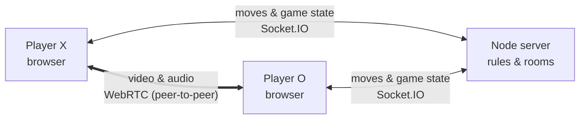

# 3D Tic Tac Toe


<!-- **Live demo:** https://your-site.example  ·  add a short gameplay GIF here -->

Real-time multiplayer tic tac toe on a **3×3×3 cube**, with **built-in video chat**.

Share a room link, rotate the cube, and get three in a row in any direction, including straight through the centre. Players can see and hear each other while they play, and anyone else who opens the link can watch as a spectator.

---

## Features

- **3D board.** 27 cells you can rotate, zoom and click, with smooth hover and win animations.
- **Layer view.** Three flat 3×3 boards show each slice of the cube. Hovering one highlights that slice in 3D.
- **Rooms by link.** Create a room and share the URL (`/?room=abc123`). No sign-up needed.
- **Server-checked moves.** The server validates every move, so out-of-turn moves, overwrites and console tricks are rejected.
- **Spectators.** Extra visitors can watch but can't move or reset.
- **Series score.** "Play Again" clears the board and keeps the running score.
- **Video and audio chat.** Peer-to-peer WebRTC with mute and camera toggles and a draggable panel.
- **Works on tough networks.** TURN relay support, connection retries, a status indicator, and graceful fallback when there's no camera or mic.

---

## How It Works



| Part | Responsibility |
|---|---|
| **Browser** | Draws the 3D cube and the side panel, captures clicks, and shows the video |
| **Server** | Owns each room's state, validates moves, detects wins, tracks scores, and relays WebRTC setup messages |
| **WebRTC** | Sends video and audio directly between browsers. The server never carries media. |

**Server-authoritative.** The client only *requests* a move. The server checks that the cell is a real one (0–26), that the sender is a player, that it's their turn, that the cell is empty and that the game isn't over. Then it broadcasts the full updated state to everyone in the room.

**The board** is a flat array of 27 cells indexed by `x * 9 + y * 3 + z`. All **49 winning lines** (27 straight, 18 face diagonals, 4 space diagonals) are precomputed once, and checking for a win is a scan of that list.

**Video** uses a mesh: everyone in the room connects to everyone else. The newest participant always starts the call, which avoids collisions. Incoming setup messages are queued until local media is ready, and TURN credentials are fetched by the server so the API key never reaches the browser.

A closer look at the trickiest code is in [IMPORTANT_CODE.md](IMPORTANT_CODE.md).

---

## Tech Stack

| Area | Technology |
|---|---|
| Frontend | React 19, Vite 7 |
| 3D | Three.js, React Three Fiber, Drei |
| Backend | Node.js, Express 5 |
| Real-time | Socket.IO 4 |
| Video | WebRTC, STUN / TURN (Metered) |
| Testing | Node's built-in test runner, socket.io-client |
| CI | GitHub Actions |

---

## Project Structure

```
client/
  src/
    App.jsx                   landing page, or the game when ?room= is present
    network/socket.js         shared Socket.IO connection
    game/winLines.js          the 49 winning lines
    hooks/useDraggable.js     drag behaviour for the video panel
    components/
      LandingPage.jsx         create / join a room
      Game.jsx                game state and server events
      CubeGrid.jsx            the 3D board
      GameUI.jsx              HUD: role, turn, score, room link, layer boards
      VideoChat.jsx           WebRTC mesh and media controls

server/
  game.js                     game rules as pure functions
  app.js                      HTTP + Socket.IO server (rooms, events, signaling)
  index.js                    entry point: config + listen
  winLines.js                 server copy of the winning lines
  test/                       unit tests and socket integration tests
```

---

## Getting Started

**Requirements:** Node.js 20 or later.

```bash
# 1. Server  →  http://localhost:3001
cd server
npm install
npm start
```

```bash
# 2. Client  →  http://localhost:5173
cd client
cp .env.example .env        # points the client at the local server
npm install
npm run dev
```

Open `http://localhost:5173`, click **Create Room**, and open the same link in a second tab to play. A third tab joins as a spectator.

> Camera and microphone access requires `localhost` or HTTPS.

### Configuration

| Where | Variable | Purpose |
|---|---|---|
| server | `PORT` | Port to listen on (default `3001`) |
| server | `METERED_API_KEY` | Enables TURN relay servers (optional; STUN is used without it) |
| server | `CLIENT_ORIGIN` | Allowed frontend origin(s), comma-separated (default: any) |
| client | `VITE_SERVER_URL` | Backend URL the client connects to |

---

## Testing

```bash
cd server
npm test
```

40 tests in two groups:
- **Rule tests** (`game.test.js`): every winning line, move validation (turn, occupied cell, spectators, out-of-range input), seat handling on disconnect, reset behaviour, and a check that the client's and server's winning lines match.
- **Integration tests** (`socket.test.js`): a real server with real socket clients, covering role assignment, broadcasts, rejected moves, room-full and spectating, disconnects, targeted WebRTC signal relay, and the health endpoint.

GitHub Actions runs the tests, lint and a production build on every push.

---

## Deployment

- **Server:** any Node host that supports WebSockets (for example Render). Start command `npm start`. Set `METERED_API_KEY` and `CLIENT_ORIGIN`. `GET /health` is available for uptime checks.
- **Client:** any static host (for example Vercel, Netlify or Render). Set `VITE_SERVER_URL`, run `npm run build`, and serve `client/dist`.

---

## Roadmap

- Shared room state in Redis, so the server can scale horizontally
- An SFU for larger video rooms
- Reclaim your seat after a page refresh
- An AI opponent (minimax with alpha-beta pruning)
- Browser end-to-end tests with fake media devices

---

## Author

Built by [Aniket Pandey](https://github.com/rogueslasher).
